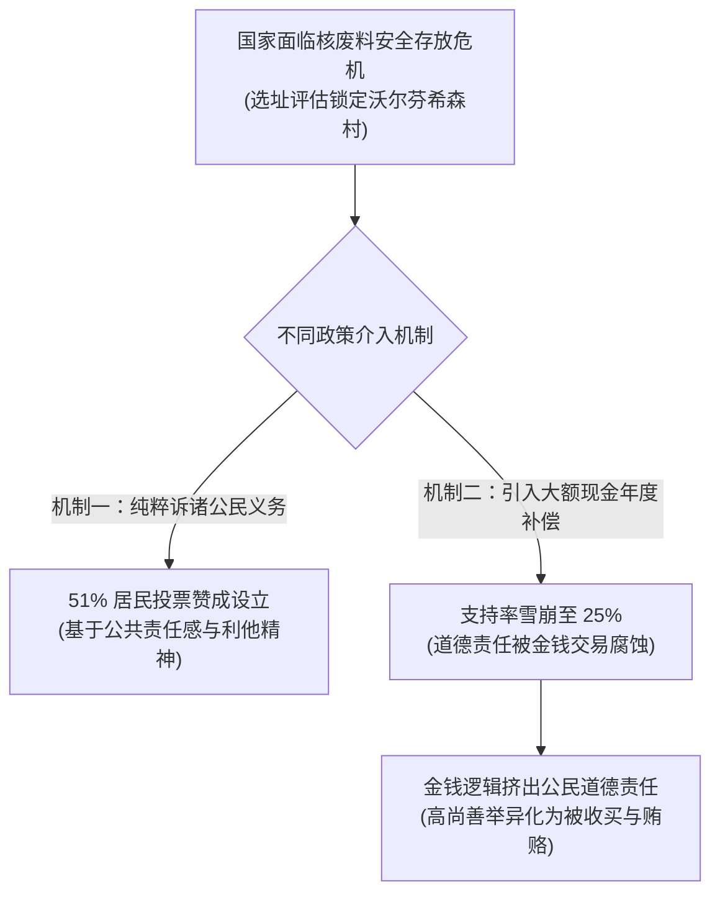
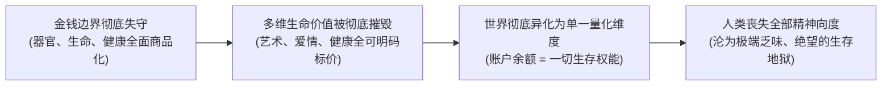
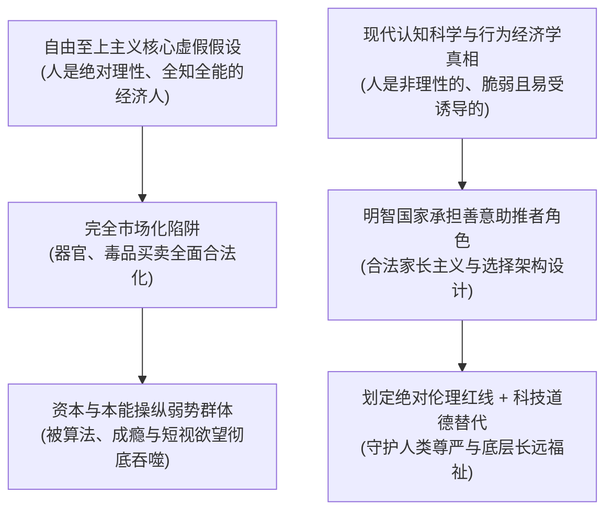

### 破除直觉依赖：从情绪反感到理性道德建构

大家好，本期《大问题》节目要探讨的核心大问题是：买卖人体器官在道德上究竟能否被接受（Is organ trafficking morally acceptable?）？

在讨论正式展开的最开始，首先必须旗帜鲜明地申明我们的基本立场：我们坚决反对买卖器官，不赞成任何形式的买卖器官行为，这其中包括买卖人体器官、买卖血液以及有偿代孕等一切人体商品化行为。

那么，也许很多人立刻就会产生疑问：既然你都已经旗帜鲜明地表明了反对立场，那这期节目还有什么好继续掰扯的呢？直接宣判买卖器官是不道德的、是反人类的，然后直接结束节目不就行了吗？

问题的关键在于，我们是明事理的人，或者说，我们始终希望自己能够成为真正明事理的人。我们反对一件事情，绝不能仅仅停留在出于本能直觉上的生理反感，或者依仗某种公权力与武力上的强制压制。我们必须在道理上彻底说清楚，为什么买卖器官在伦理与道德哲学上是不合乎正义与道德的。任何仅仅凭借朴素道德直觉、群体情绪或国家强制权力做出的价值断言，在逻辑根基上都是极度不稳固的。它必须经过严格理性的审视，获得严密道理的加持，才够得上面对复杂现实时一个站得住脚的坚实论断。

之所以需要专门用一整期的篇幅来深度剖析这个话题，原因还在于它是一个极具思辨深度与迷惑性的伦理试金石。在现实学术界与公共舆论中，支持器官买卖的学者给出的一整套论证体系，在很多人听起来其实是相当具有说服力且逻辑严密的。这些支持者的理由往往依托于现代经济学原理和经典权利哲学，听起来论据扎实、论证环环相扣且极具雄辩色彩。

正因如此，很多缺乏系统批判性思维和哲学思辨训练的人在听了这些论据之后，往往在道理层面哑口无言，完全无法在逻辑上反制对方。最终，他们只能无奈地退回到一种极其反智的防御立场：“我不管，我不要，反正我主观上就是不喜欢、就是无法接受。”如果我们坚决反对一件事情，却在理性层面上既无法说服自己，更无法在辩论中说服别人，这在智识追求上是非常可悲的。

因此，本期节目我们将从纯粹的哲学、伦理学与经济学逻辑出发，彻底厘清器官买卖背后的底层争议。我们系统查阅并梳理了大量专业资料与学术文献，分别提炼了支持器官交易的正方学者观点与坚决反对的反方学者立场。我们将首先毫无保留地呈现正方支持器官买卖的几大核心支柱，展示其逻辑力量；随后，我们将进入反方视角，层层拆解并正面反驳正方的每一项论点。希望各位朋友在完整审视这场理智交锋之后，共同评估这场反驳究竟是否足够有力与成功。

---

### 正方立论根基：供需鸿沟下的现实功利主义与帕累托改进

在正式开启这场思想交锋之前，我们必须首先严格限定今天所讨论的论题边界。

我们在此所探讨的器官买卖，特指在合法的制度框架内，通过公开、透明的市场交换手段实现的人体器官自愿交易。首先必须坚决排除任何通过暴力绑架、身体强迫、欺诈瞒骗或非法黑市拐卖等手段获取器官的恶劣刑事犯罪。我们今天所设定的讨论基准，完全建立在交易当事人在充分知情、意识清醒且明确同意的前提下，所自愿做出的器官交易行为。利用暴力强迫或欺骗他人出卖肉体器官，在任何文明社会的法理与伦理下都是绝对不合乎道德且必须严惩的违法犯罪行为，这一点毫无任何辩驳与讨论的余地。

在明确划定这一讨论边界之后，正方支持器官买卖的第一个核心论据，是一个极其沉重且无法回避的客观现实——那就是在当今现代医学的器官移植临床实践中，可供移植的器官缺口极其巨大，面临着近乎绝望的供需危机。

我们不妨以临床需求最为庞大的肾脏移植为例。在全人类所有的实体器官移植手术中，肾脏移植占据了总体手术量的七成以上，是绝对的核心需求。在现实生活中，存在着数量极其庞大的终末期器官衰竭患者，必须依靠换肾手术才能维持生命，最典型的就是尿毒症患者。以中国的数据为例，每年大约有高达150万名尿毒症患者在生死边缘挣扎，急需接受肾脏移植手术来拯救生命。从纯粹的现代外科学技术层面来看，肾脏移植的手术方案和免疫抑制方案已经发展得相当成熟，甚至可以说是一门标准化的高成功率手术。然而，整个临床救治面临的最大死结，就在于可供合法移植的人体供体肾脏存在极其悬殊的短缺。

目前全球各国通行的器官获取方式，主要依靠公民基于无私奉献精神的无偿自愿捐献。然而，仅仅依靠道德呼吁、精神赞美与公民崇高的高尚道德情操来动员社会提供器官，究竟能够杯水车薪地解决多少问题？残酷的现实统计数据给出了冰冷的答案。根据**世界卫生组织**（World Health Organization: 负责全球公共卫生事务与医疗标准制定的联合国专门机构）的全球官方统计，全世界目前急需接受器官移植手术的重症病患数量，与全社会能够募集到的合法自愿捐献器官数量之间，供需比例高达惊人的 **30:1**。这就意味着，在平均每30个处于绝望之中、急切等待换肾续命的病患背后，全社会仅能提供1个匹配的肾脏供体供他们排队争夺。

这种供需关系的严重倒挂，直接导致绝大多数登记在册的重症患者根本无法在生命耗尽前等到可用的供体器官，只能在漫长而痛苦的透析等待中绝望地走向死亡。根据欧洲委员会的统计数据，仅仅在2019年一年之内，欧洲就有超过6000名危重病患因为迟迟等不到器官供体而衰竭死亡；平均折算下来，相当于整个欧洲每天都有18名鲜活的患者仅仅因为器官短缺而失去生命。而中国的人口基数大，器官供需失衡的严峻程度更甚：在前述提到的中国每年150万名急需肾移植的尿毒症患者中，最终真正能够幸运获得可供移植肾脏的患者比例仅仅只有区区 **1%** 左右。

在直面了如此残酷的生命凋零数据之后，正方迅速引入了基础现代经济学的供求定价机制：

现代经济学基本原理清晰地揭示了一个规律：当市场上某种具有高价值的物品处于极端稀缺、供不应求的状态时，在没有价格管制的自愿交易环境下，其交换价格必然会上涨；而价格上涨带来的丰厚收益预期，会迅速刺激更多潜在的资源持有者自愿提供供给，进而有效平抑稀缺状态，实现供需重新平衡。

如果按照现行的道德模式，仅仅依靠精神嘉奖或者仅仅提供一万美金的微薄补偿，很多原本生活平稳的普通人可能会觉得出卖自身器官在经济上很不划算，因而不愿提供；那么，如果是五万美金呢？十万美金呢？甚至五十万美金呢？在自由市场机制下，这个补偿价格完全可以跟随不同时期的供求紧缺程度随行就市、动态调整。当器官稀缺到达极度危急的生命关头，买方为了保全生命必然愿意支付更高的溢价，器官的市场出清价格就会自然攀升；而随着价格水涨船高，全社会愿意主动出卖多余肾脏的人群规模必然会显著扩大。

这便是经济学逻辑的必然推论：人类完全可以善用市场价格信号的杠杆力量，打破纯粹道德动员的效率瓶颈，极大地刺激和释放人体器官的社会供给，从而让千千万万目前只能坐以待毙、生命垂危的重症病患获得重新活下去的宝贵机会。

从人体生理结构的角度来看，绝大多数正常人类都天生拥有两颗肾脏，而在现代医学严密监测与健康管理下，一个人在捐献或卖掉其中一颗肾脏之后，依靠仅存的一颗健康肾脏依然能够维持正常的机体代谢并健康地存活下去。试设想这样一个现实图景：在某一个极端贫困的山区家庭中，一位含辛茹苦的父亲面临着极度现实的生存困境——他的女儿今年以优异的成绩考上了重点大学，但整个家庭一贫如洗，无论如何也凑不齐高昂的学费和生活费，眼看孩子的求学前途和人生希望就要彻底断送。此时，如果法律允许合法的器官交易，这位父亲完全可以通过自愿出卖自己多余的一颗肾脏，一次性筹措到足以支撑女儿完成高等教育的学费，同时还能结余一笔启动资金彻底改变家庭原先贫病交加的绝望处境。

正方学者在此提炼出了一个极具吸引力的经济学模型：一方面，生命垂危的尿毒症患者通过支付合理的金钱对价，顺利买到了能够救命的健康肾脏，将自己从死亡线上拉了回来；另一方面，处于财务绝境中的供体家庭通过合法出卖自身身体冗余的器官，获得了改变整个家庭命运轨迹的巨额急需资金，生活福利得到了实质性改善；与此同时，实施救治手术的医疗机构和医护人员也凭借精湛的专业技术合法合规地获取了应得的技术服务利润。

在现代福利经济学中，这种状态被精准地定义为一种典型的**帕累托改进**（Pareto Improvement: 在资源分配过程中，在没有任何一个个体利益遭受净损失的前提下，至少使某一个个体甚至所有个体的福利状况得到净提升的优化状态）。简而言之，就是全流程中参与的各方都各取所需、福利倍增，呈现出一种“你好、我好、大家好”的共赢局面。既然这在客观效果上是一件让每个参与者都能摆脱困境、实现福利最大化的好事情，那么保守的伦理学者们究竟又在盲目反对什么呢？

---

### 自由至上主义护翼：自我所有权与知情同意下的风险自担

当然，面对上述纯粹功利主义与市场效率的辩护，很多反对者立刻会提出尖锐的生理与健康质疑：人体经过数百万年的自然进化，长出两颗肾脏必然有其深层的生理冗余价值；无论外科手术多么精细，失去一个重要内脏器官必然会在长期不可逆地削弱人体的免疫代偿机制与抗风险能力。一个文明进步的现代社会，怎么能通过法律和金钱激励，公然鼓励底层民众去主动做出永久性伤害自身身体健康的自残行为呢？

针对这种来自医学与人道主义的质疑，正方学者给出了极其坚决的理论反驳。首先，正如前文所阐述的医学事实，人体确实具备强大的生理代偿机制，健康成年人保留一颗肾脏完全能够支撑起长期的基础生命活动。虽然少了一颗肾脏之后，这个人在生理机能上多多少少会承受一定的负面影响，比如他未来可能无法再从事超强度的重体力劳动，或者永远失去了成为一名职业极限运动员的潜质；但是，正方学者明确指出：这场争论的核心焦点，根本就不在于当事人出卖器官后究竟承受了多大程度的生理损失！

这场伦理较量的真正核心，在于一个极其根本且神圣不可侵犯的现代政治哲学与道义论支柱——那就是：每一个心智健全的自由人，都天然拥有自主权，并有权且有责任自行承担自身理性决策所带来的一切风险。

这便是正方立论中最为硬核的第二大理论支柱——**自由至上主义**（Libertarianism: 主张个体自由高于一切、强调个人权利的神圣性、极力限制国家干涉的政治哲学派系）。这一理论的奠基性概念，正是哈佛大学著名哲学家罗伯特·诺齐克（Robert Nozick）所系统阐发的**自我所有权**（Self-Ownership: 每个人对其自身的身体、心智以及由自身劳动所产生的成果拥有排他性的绝对所有权与支配权）。

所谓自我所有权，用最朴素的话来说，就是“我身即我主，只有我自己才是我自己身心的真正主人”。个体对于自己的生理躯体，以及完全由自己的身体所直接创造出的一切物质或精神产品，拥有毋庸置疑、不可剥夺的绝对所有权。无论是任何打着崇高旗号的其他个人、社会群体，还是手握强制机器的政府机构，都绝对无权侵犯、剥夺或强行干预个体对自身肉体的自主支配。

自我所有权的核心逻辑演进清晰明确：
1. **个体主权的确立**：人对其身体及派生产品拥有排他性支配权；
2. **免受侵犯的自由**：只要个体行为未直接侵害他人的合法权利，其支配行为即具备正当性；
3. **身体处分权的外延**：这一主权逻辑同样适用于器官买卖、代孕、堕胎及危险职业选择等领域。

如果我们将自我所有权的逻辑严丝合缝地平移到器官交易的讨论语境之中：一个具备完全民事行为能力、心智健全的理性成年人，只要他的行为没有直接侵犯、掠夺或伤害任何第三方无辜者的合法权益，他就天然享有依照自己的主观真实意愿，自由处分、转让乃至有偿出售自己身体任何一部分的绝对自由权利。

不可否认，卖掉一颗肾脏客观上确实会对未来的身体机能带来潜在的健康折损风险与生理代价。但是，人类生存在这个充满不确定性的世界上，所做出的任何一项重大人生决策——无论是选择背井离乡去外地打拼、选择从事高压力的繁重工作，还是选择在烈日下辛勤劳作——本质上都是一场关于预期收益与潜在成本之间的理性权衡。既然这位成年当事人在经过深思熟虑之后，依然坚定地选择出卖自己的肾脏，那么在当事人自己的主观效用评价体系中，这必然是他权衡再三后的最优解。在他看来，用一颗肾脏的潜在健康风险去换取一笔能够彻底改变女儿一生命运的高等教育学费，其道德价值与现实意义远远超越了保留两颗肾脏所带来的生理舒适。

真正捍卫人权的现代文明，应当无条件尊重一个独立自主的个体在绝境中做出的自愿理性抉择，而不是高高在上地站在一种居高临下的“道德上帝视角”，粗暴剥夺弱势群体基于自身现实考量做出自由选择的法定权利。那些养尊处优、衣食无忧的精英阶层，若是凭借自身站着说话不腰疼的抽象道德洁癖，立法强行禁止底层贫困民众通过自愿出卖身体器官来换取救命资金，这种行为在本质上才是对个体自主权的野蛮践踏。你义正辞严地立法剥夺了他卖肾自救的最后一条生路，请问，你愿意代替他掏出真金白银，替他承担他女儿迫在眉睫的大学学费和全家人的生计开销吗？如果你不能，你凭什么以“保护他”的名义将他推入绝境？

---

### 逻辑一致性与安全规范化：职业风险报酬类比与阳光化监管

在完成了功利主义与权利哲学的论证之后，正方学者乘胜追击，抛出了支持器官买卖的第三个关键论据——一个基于纯粹逻辑一致性的严密类比论证。

在当前的全球主流法律与社会伦理实践中，获取他人活体器官的唯一合法合规途径，是源于公众完全无偿、没有任何经济利益回报的自愿爱心捐献。这种利他主义的无偿捐赠行为，在任何社会语境下不仅被主流意识形态完全许可，而且会被赋予极其崇高的道德光环，受到全社会的普遍赞美与由衷敬仰。然而，一旦有当事人在同样的捐献流程中收取了一定数额的金钱经济报酬，这种行为立刻就会被法律认定为非法犯罪，在社会舆论中遭到千夫所指的严厉道德谴责。

正方学者尖锐地指出，这种两极分化的社会态度在严密的哲学逻辑上是完全自我割裂、根本无法自圆其说的。

让我们深入剖析这两种行为的客观物理实质：无论是无偿捐献器官，还是有偿出售器官，这两类行为在纯粹的医学事实与物理本质上是完全等同的——当事人都是自愿躺上手术台，主动承受外科麻醉与手术切除带来的身体创伤与生命健康风险，并将从自己身体内部取出的健康器官完整提供给生命垂危的重症移植受体。这是两者之间百分之百完全相同的核心实质。而这两者之间仅存的唯一物理与社会区别，无非就在于：前者在术后两手空空地离开，没有收取分文经济对价；而后者在术后合理合规地收取了一笔由市场自愿支付的金钱经济报酬。

难道仅仅因为一个人在承担重大身体风险救人时没有收钱，这件事情就天然是纯洁而崇高的；而一旦他在承受了同等甚至更大的身体风险之后合理索取了金钱回报，这件事情就立刻堕落为十恶不赦的道德罪恶了吗？

为了进一步证明这一逻辑的荒谬，正方引入了现代社会中广泛存在的各类**高危职业风险补偿**机制。在这个世界上，人类社会为了正常运转，每天都依赖着大量需要个体主动承担极大健康危害与生命危险的高危职业，最典型的就是直面烈火浓烟的消防队员，以及随时可能遭遇武装歹徒殊死搏斗的武装警察。消防员需要在烈焰与有毒烟气中舍生忘死地冲入火场搜救被困人员，警察需要将自己的生命置于枪林弹雨之中与暴徒正面对抗，这些职业所面临的身体伤残概率与瞬间死亡风险，在客观统计上远远超越了一台正规医院内部的活体肾切除手术。

对于这些从事高危致命工作的专业人员，全社会没有任何一个人会认为给予他们丰厚的金钱薪资、危险津贴与丰厚的养老保险存在任何道德瑕疵。消防员和警察流血流汗保卫公众安全，理直气壮地按月领取高额的金钱劳动报酬，在全人类看来都是天经地义、完全合乎道德与社会契约的正常秩序。那么，为什么当一位普通人自愿承受了外科手术的健康折损，直接将自己身体内部的器官奉献出来挽救另一个公民的生命时，社会却突然翻脸，认为给予其对等的金钱报酬反而是不可容忍的伦理堕落呢？这种双重标准的道德评判在逻辑同一性上是完全崩塌的。

固然，面对火海救人与勇斗持枪歹徒这类极端危险的场景，现实中也偶有不计个人安危、分文不取的民间见义勇为英雄挺身而出。全人类社会必然会在道德层面对这些毫无私心杂念、自愿奉献生命的崇高勇士报以最高的礼赞与敬意。但是，全社会绝不会因为广大消防战士和人民警察每月按时领取了国家发放的工资报酬，就站在道德制高点上贬低他们的职业崇高性，甚至荒谬地指责他们从事的工作是“不道德的”、“卑劣的金钱交易”。相反，现代文明毫不犹豫地认定，无论是无偿奉献的民间孤胆英雄，还是领取合法报酬的职业救护人员，他们在客观拯救人类生命的崇高事业中，都同样具备无可置疑的道德正当性。既然如此，对待人体器官的提供者，社会凭什么仅仅依据“是否收受对价”这一外部金钱因素，就将同样承担了巨大身体代价的提供者粗暴切割为“高尚的奉献圣人”与“卑鄙的违法罪犯”？

紧接着，正方抛出了其立论的第四与第五项务实论据，直接打消了公众对于技术安全性与地下黑市泛滥的传统疑虑：

第四，关于外科手术与长期生存的**技术安全性保障**。伴随着微创外科技术、先进生命体征监护系统以及现代免疫抑制剂的突飞猛进，活体器官切除与移植手术在正规三甲医疗机构中已经成为一门极度成熟、风险高度受控的外科常规手术。对于接受移植的重症患者而言，其术后生存期与生活质量获得了颠覆性的改善。以中国权威外科学专家、北京大学人民医院肝胆外科主任、北京大学器官移植研究所所长朱继业教授在权威医学访谈中披露的真实临床数据为例：我国接受正规肝脏移植手术的危重患者，其术后一年生存率高达约 **87%**，三年生存率稳定在 **80%** 左右，大量移植受体在术后长期保持着极其健康的生理状态与正常生活能力。

而对于那些主动出卖并提供自身单个健康器官的供体而言，现代循证医学同样证明其长期医学风险被外界舆论严重夸大了。根据英国国家医疗服务体系（National Health Service: 英国统一的公共卫生与国民医疗保障系统）长期追踪的大样本权威医学统计：活体器官捐献者/提供者在正规医疗体系下实施手术的术后死亡概率仅为极其微小的 **1/3000**；出现轻微局部术后并发症（如浅表切口感染或短期尿路感染）的发生概率同样严格低于 **1%**；而在长达数十年乃至终身的远期随访中，英国 NHS 的严谨追踪数据明确证实：那些健康成年后切除了一颗肾脏的单肾人群，其一生中发生慢性终末期肾功能衰竭的统计学概率，与天生拥有两颗肾脏的普通对照人群相比，在流行病学上并不存在统计学上的显著增高。

此时，反对者往往会情绪激动地搬出现实中耸人听闻的黑市悲剧反驳道：上述看似完美安全的医学统计全都是建立在顶级公立大学附属医院的标准层流手术室之中的！而在现实社会中，器官交易充斥着大量暗无天日的地下非法黑诊所与无证小作坊，那些地方手术环境极度污秽恶劣、医疗抢救设备极度匮乏，不仅让底层供体术后遭受严重的暴发性感染、留下终身残疾的严重后遗症，甚至频频在手术台酿成供体与受体当场暴毙的严重医疗事故！

然而，面对反对者对地下黑作坊罪恶的控诉，正方学者给出了绝妙的因果逻辑反击：

这恰恰是正方的第五大核心论据——**非法化才是滋生黑市罪恶的万恶之源**。正是因为官方在法律上对器官交易实行了全面一刀切的绝对死刑，才强行将庞大的客观医疗刚需与底层生存诉求逼入了无法无天的阴暗地下角落！

正方在此深刻援引了20世纪20年代美国联邦政府推行**禁酒令**（Prohibition Era: 1920年至1933年间美国宪法修正案所确立的全面禁止酒精饮料生产、销售与运输的失败历史政策）的惨痛历史教训：人类社会的某些深层客观需求与经济交换规律，绝不是统治者单凭一纸冰冷的行政道德禁令就能够彻底消除的。当年美国政府以保护国民道德与家庭健康为由，强行在全美境内全面封杀合法酒类的生产与流通；然而，这一道德禁令不仅没有消灭酒精消费，反而瞬间催生出了一个庞大、残暴且无法无天的地下私酒黑市网络。原本公开透明的酿酒商业被残暴的黑帮家族全面垄断接管，假酒泛滥成灾导致成千上万底层民众失明甚至丧命，公职人员大面积遭受黑金腐败侵蚀，整个社会陷入了无休止的黑帮枪战与治安恶化之中。直到后来美国政府幡然醒悟，彻底废除禁酒令、恢复合法的酒精商业流通与政府质量牌照监管，私酒黑帮及其滋生的一切暴力罪恶才瞬间土崩瓦解。

同理，正方学者极力呼吁打破道德教条、全面开放合法受控的器官自愿买卖市场。这一改革最为直接的制度红利，就是能够将原本深藏在下水道里的地下器官交易彻底拉到阳光之下，让其置于国家公共卫生体系、执业医师伦理委员会与司法机关最严密、最透明、最标准化的法治监管网络之中：

* **准入前医学筛查**：每一位意图出售器官的公民，必须强制在公立医院接受资深专家组的多轮全面医学体检与心理精神评估；对于本就存在基础隐匿疾病、身体素质虚弱、切除单个器官后极易引发代谢衰竭的脆弱人群，医疗系统将一律坚决驳回其交易申请；仅严格允许那些身体机能优异、经医学严谨证实即使切除单肾依然能够长期健康生活的高质量个体参与交易。
* **专业医疗环境护航**：所有的实体器官摘除与移植手术，必须被严格限定在具备最高资质认证的国家级综合医院内，由资深正高职称的外科专家团队亲自操刀主刀，全流程匹配顶级无菌层流手术室与术后重症监护支持，从而在源头上将手术致死致残率压低至医学极限。
* **金融与衍生机制创新**：一旦器官交易在法律层面上彻底洗脱罪名、实现合规合法化，其在商业运作与金融衍生工具的设计上将会衍生出极其丰富且充满人性化温情的机制设计。例如，针对很多人对“活体摘肾”在心理和视觉上难以逾越的恐惧本能，现代市场机制完全可以顺理成章地开发出**遗体器官期货交易合约**（Organ Futures Contract: 允许个体在生前签署受法律保护的期权协议，约定在自然死亡后将健康器官交由医疗系统商业化处置，而在生前即可提前折现享受全额经济补偿的金融衍生契约）。

在这一极具创意的市场构想中，专业的商业人寿保险公司完全可以大有作为。保险机构可以组织顶尖的医疗专家与精算师团队，对自愿投保的健康青年进行全面的生理评估，精确测算出其体内全套器官在其未来百年自然身故后所能创造的总体医疗救治价值；随后，精算模型综合考虑其预期自然寿命、贴现折现率与通货膨胀预期，在其二三十岁正值青年创业、最急需资金的关键人生阶段，由保险公司直接为其提前一次性贴现支付一大笔丰厚的真金白银。当事人在青年时代拿到了急需的启动资本改变了个人命运，生前尽情享受了这笔财富带来的生活福祉，而在其百年自然身故之后，其遗体器官又合法合规地为人类公共医疗事业与垂危重症病患做出了卓越的救死扶伤贡献。

这不仅在现实后果上彻底化解了器官短缺的世纪难题，在道义上完全契合了自我所有权的人权哲学，在逻辑上保持了高危职业补偿的严密一致，在技术上依托阳光化监管斩断了黑市毒瘤，更在制度创新上达成了超越时代的帕累托福利最大化。

这便是正方学者建立在现实理性、自由权利与市场效率之上的宏大立论大厦。

---

### 反方哲学反制：市场极限、金钱腐蚀与无偿利他的挤出效应

面对正方看似无懈可击、逻辑雄辩的理论架构，反方展开了深层哲学维度的全面反击与体系解构。反对器官买卖的哲学防线同样横跨多个严密层次，而贯穿这些层面的核心脉络是完全相通的——那就是对“市场至上主义”狂妄越界的深度反思与严正批判。

反方的第一道核心理论防线，正是当代享誉全球的政治哲学家、哈佛大学讲座教授迈克尔·桑德尔（Michael Sandel）在其传世名著《金钱不能买什么：金钱与公正的局限》中所深刻确立的经典伦理命题：**当我们将某种真正具有崇高内在价值的好东西（Good）任意进行明码标价并推入市场买卖时，金钱交易不仅无法实现中性的资源优化配置，反而会从根本上腐蚀、贬损并彻底毁灭这种好东西所固有的内在崇高价值。**

这道理论命题的核心要旨在于：在这个人类所生存的复杂世界里，绝非世间一切有价值的资源都天然适合交由自由市场的无形之手来调节与分配。那些原教旨主义的市场信徒们，盲目沉迷于一种天真的乌托邦教条，狂妄地宣称世界上所有稀缺资源只要通过市场价格机制的自由博弈，就能精准实现帕累托最优，让最有价值的物品自然流向出价最高、最懂得利用它的人手中。

然而，冷酷的人类文明实践早已千百次无情地戳破了这一神话。

一个最直观、全人类都能达成绝对共识的反面例证，就是政府公职人员手中的公共权力。公权力之所以具有正当性，在于其代表全体公民的托付与公共利益的公正行使；如果按照市场至上主义者的逻辑，公权力既然也是一种稀缺资源，是不是也应该通过公开拍卖、随行就市的竞价机制价高者得呢？如果谁出钱多谁就能购买到裁判文书、行政审批甚至执法特权，这在人类任何语言体系中都不叫资源优化配置，这在字面意义上就叫做权钱交易，叫做彻头彻尾、动摇社会根基的严重政治腐败。

我们再将目光从宏观政治拉回到每个人日常真实的情感生活之中。假设一对相濡以沫、恋爱多年的情侣在某一天爆发了激烈的口角与矛盾。在情绪崩溃的争吵中，一方痛苦地委屈埋怨道：“多年来我为你毫无保留地付出了我全部的青春、陪伴与真挚情感，而你却始终冷酷自私，根本不把我真正放在心上！”此时，如果对方冷冰冰地从兜里掏出手机，极其理性且高傲地回应道：“好，既然你觉得你吃亏了，那我现在就把过去几年里你送我的每一件生日礼物、请我吃过的每一顿饭、一起看电影的所有开销，连本带利折合成市场公允价格，通过微信转账一分不差地全额还给你！”

试想一下，当那一串冰冷的转账数字发送过去、金钱交易完成的瞬间，这两个人之间曾经真挚热烈的情感纽带会发生什么？毫无疑问，这二人之间深厚纯粹的爱情联结在这一瞬间彻底宣告脑死亡与彻底粉碎。虽然中国古老民间智慧常说“亲兄弟，明算账”，但现代人类精神生活的深刻真相恰恰在于：在人类文明的高维精神秩序中，恰恰存在着极其关键的一大批神圣事物，是绝对、万万不能拿来明算账的！

一旦你试图将无价的情感、尊严与肉体强行折算为冰冷等价的通用货币，这件物品自身所天然蕴含的崇高精神价值、道德庄严感以及人际温情，就会在瞬间被彻底腐蚀殆尽。一旦世间万物都沦落为可以随意用钞票购买的普通商品，人类生命最深邃的滋味便彻底荡然无存。

在宏观公共伦理层面，这种金钱标价对美好事物的致命腐蚀，最为直接且致命的体现就是它会引发严重的**挤出效应**（Crowding-Out Effect: 外部金钱物质激励的野蛮介入，破坏并驱逐了个体原本基于崇高内在道德、公民义务或无私利他主义动机去从事善举的心理机制）。

在器官移植的现实语境下，这一经济与心理规律简单而残酷：**一旦法律正式允许身体器官可以堂而皇之地明码标价上市售卖，那么全社会原本出于至高无上的利他主义道德情操而自愿签署器官捐献协议的公民网络，将在极短时间内遭遇毁灭性的心理塌陷与彻底瓦解！**

让我们代入那些原本满怀神圣情怀的潜在无偿捐献者的内心深处：在没有商业买卖的环境下，一个人签署死后器官捐赠书，他是在践行一种纯洁无瑕的现代公民博爱精神，他为自己能够在离开人世后无私挽救同胞生命而感到无上的崇高与自豪。然而，一旦社会将器官买卖全面商业化，市场上充斥着大量依靠卖肾换取大笔横财的职业卖家与商业经纪人，这位潜在的崇高捐献者会产生怎样的心理震荡？

他的崇高奉献欲会在瞬间被恶心与自我怀疑所熄灭——“我原本是怀抱着对人类同胞最崇高的爱，甘愿在死后奉献出自己圣洁的躯体去拯救生命；然而你们现在的制度设计，却公然将我这种无私奉献的圣洁善举，强行与那些唯利是图、待价而沽的商业交易拉低到同一个充斥着铜臭味的平庸水平线上！如果我的器官捐出去之后，被转手包装进充斥着巨额利润和价格歧视的医疗产业链中，我凭什么还要去做这个廉价的冤大头？我坚决不再干了！”

迈克尔·桑德尔教授在其专著中，援引了欧洲现代社会学研究中极具震撼力的**瑞士核废料选址民意调查经典案例**：

在20世纪90年代，高度依赖清洁核电的瑞士联邦政府面临着一个极其棘手的国家级战略难题——必须在境内寻找一个地质构造极度稳定安全的永久性高放射性核废料深层地质储存库。经过国家权威地质专家组极其严密详尽的实地勘探与科学论证，最终得出确凿结论：将全瑞士唯一的核废料深层储存设施，设立在境内一个名为沃尔芬希森（Wolfenschiessen）的平静宁谧阿尔卑斯小山村附近，在工程与地质科学上是最优且最安全的方案。

然而，无论防护工程做得多么固若金汤，核废料设施的进驻在客观上与心理上必然会给当地世代定居的村民带来潜在的安全顾虑与生活阴影。于是，专业社会学家与经济学家团队在获得瑞士国会授权后，深入该山村对全体常住原住民进行了一场极其严肃的封闭式民意公投测验。

在第一轮基准民意测验中，调查团队向全村居民抛出了最直接的严肃问题：“如果瑞士联邦国会经过严谨的科学论证，最终依法决定将全国的永久性核废料深层储存库设立在各位所在的沃尔芬希森村附近，考虑到国家的整体能源安全与公共福祉，你们个人是否愿意投票投下赞成票？”

测验的统计结果令人肃然起敬：在没有任何物质补偿承诺的情况下，全村竟然有高达 **51%** 的微弱多数居民坚定地投下了赞成票。显然，在这场涉及国家命运的抉择面前，是深植于现代文明公民内心的公共责任感、集体精神与对国家共同体义不容辞的公民义务感，战胜了人性深处的本能自私，促使超过半数的朴实村民勇敢地选择为了全体同胞的利益而主动承担起这一份沉甸甸的历史重担。

然而，荒谬的一幕紧接着上演了。深谙传统经济学激励理论的研究学者们随后展开了第二版对照民意调查。在这一版本中，调查问卷附加了一个极其丰厚的经济诱饵：“如果瑞士国会决定将核废料储存库设立在你们村庄附近，作为对各位居民所承担风险与牺牲的补偿，联邦财政将立法确立一项永久性专项补偿基金，保证在未来的每一年，向该山村的每一位常住居民个人账户里直接无条件汇入一大笔丰厚的高额现金补偿。在拥有这笔巨额年度现金补偿的前提下，你们是否愿意支持该设施落户本村？”

按照传统经济学“物质激励越大、行为供给越多”的线性教条预期，增加了巨额现金补偿后，村民的赞成支持率理应大幅度飙升突破八九成甚至全票通过。然而，残酷的现实调研结果却让所有主流经济学家大跌眼镜：

村民的赞成支持率不仅没有发生丝毫的上升，反而呈现出灾难性的雪崩——从原先纯粹道德驱动下的 **51%**，骤然断崖式暴跌到了令人匪夷所思的 **25%**！

这个经典案例极其深刻地揭示了金钱对道德神圣性的毁灭性侵蚀：当这件事情完全不涉及金钱时，它是一场庄严肃穆的公共道德议题，村民们是在践行一种“虽然这个设施给我的村子带来了风险，但整个国家的高速运转不可或缺，既然科学论证这里最合适，我们作为这个伟大国家的公民，理应为了全社会的共同未来而展现担当”的崇高公民精神；然而，一旦冰冷的货币补偿强行介入，整件事情的性质在村民的心理认知模型中发生了彻底的堕落与变味——原本神圣崇高的公民担当，瞬间被降维扭曲成了一场肮脏、卑劣且涉嫌用臭钱收买选票与出卖健康的金钱交易！村民们会极其愤怒地质问：“你们难道以为我们山里人的健康、尊严与世代家园是可以用钞票随意购买践踏的吗？你们是在拿金钱羞辱我们的人格！”

市场机制的蛮横侵入，以一种极其傲慢而愚蠢的姿态，将社会中原本珍贵脆弱的公民义务感、利他奉献心与公共责任精神彻底排挤屠戮殆尽。

同样的悲剧如果映射到人体器官领域，后果将更具毁灭性。当合法的金钱交易彻底把人们原本出于至高无上的同情心与利他主义而自愿无偿捐献器官的慈悲之门彻底堵死挤出之后，整个社会剩下的绝大部分器官供给，将不可避免地全面堕落为纯粹建立在钞票驱动之下的肉体贩卖。

而一旦这一局面不可逆转地形成，它必然会极其迅速且必然地引爆反方提出的第二大核心灾难——**加剧极端的社会阶级不平等，形成制度化、系统化的富人阶层对赤贫阶层的合法肉体剥削！**

---

### 零和博弈与残酷现实：自由意志的虚妄与被胁迫的自我所有权

让我们撕开所有温情脉脉的经济学专业包装，深入直面这个由金钱主导的器官市场底层最真实的残酷众生相：

在现实人类社会中，究竟会有什么样的人，会甘愿走进医院的手术室，躺在冰冷的手术台上自愿让医生用柳叶刀割开自己的皮肉，活生生摘除并出卖自己健康鲜活的内脏器官？

答案毫无疑问是极其唯一且令人心碎的——**只能是这个世界上最走投无路、被贫困彻底压榨到底线的极端穷人！** 但凡一个普通人在现实生活中还保留着一丝一毫其他体面谋生、筹措资金的微薄希望，有谁会愿意把出卖自身不可再生的生理器官当作日常致富的商业选项？

而与此形成鲜明对比的是，在这个世界上，究竟又有哪一类群体能够在器官买卖市场中充当挥金如土的买方，支付得起高达数十万甚至上百万的器官采购费、顶级外科专家团队的手术费以及全套奢华的术后抗排斥治疗体系？毫无疑问，**只能是社会结构中最顶层、拥有绝对雄厚财富资本的富人阶层！**

这就无可辩驳地在法理和现实中构造出了一种最赤裸、最野蛮的人间地狱模型：整个社会的底层弱势群体，在金钱价格信号的精确诱导下，沦为了源源不断为富裕阶层输送健康肉体零部件的“人体养殖场”。而且，这种针对底层肉体的资本剥削逻辑，并不会随着市场的发展而自我纠偏，反而会在自由竞争的市场机制自我加速下愈演愈烈、滑向深渊：

一旦法律彻底大门洞开允许合法的器官商业买卖，在巨额金钱利益的强烈刺激与商业中介的大肆煽动下，必然会有成千上万在生存线上挣扎的赤贫民众涌入市场争相出卖自己的器官。正如前述正方引以为傲的供求曲线规律——当市场上可供交易的器官供给量发生爆发式剧烈暴增之后，其在自由市场中的均衡出清价格势必会发生不可逆转的大幅狂跌！

而一旦器官的市场收购价格被严重打压、腰斩乃至暴跌成廉价的地摊价，这场“卖肾求生”的残酷商业闭环，就会像致命的癌细胞一样，被逼着进一步向社会结构的最深处残酷下沉——全面渗透进那些贫困程度更深、生存环境更加恶劣、对微薄救命钱更加饥渴绝望的赤贫人群、偏远部落乃至第三世界极度赤贫的国家之中！长此以往，整个人类文明的世界图景，就会彻底演变成一幅极度残忍、毫无人道可言的荒诞反乌托邦画卷：**全球高高在上的富裕资本精英，在高度现代化的法治与契约保护伞下，跨国界、成规模、制度化地集体吸骨吮髓，全面合法化地压榨并消费着全人类最底层、最绝望、最无助群体的血肉之躯！**

这已经彻底突破了人类现代文明对公平正义的最低容忍底线，这就是在法律粉饰下公然上演的强者对弱者的极限欺凌，这就是赤裸裸、毫无遮羞布的现代肉体剥削！

在此，反方学者郑重澄清：批判器官买卖，绝不意味着我们要盲目、反智、无差别地全面否定和攻击一切市场机制。现代文明充分承认市场经济在组织生产、促进分工方面的伟大贡献；然而，人类社会存在着一种本质性的深层边界划分，绝不是所有物品都能够无条件地被塞进市场机制的绞肉机中。

区分一种特定资源究竟是否适合引入市场分配机制，存在着一个极其关键、科学且不容混淆的硬性评判标准——那就是必须严格审视这种资源在经济与物理本质上，究竟属于**正和博弈**（Positive-Sum Game: 博弈各方的利益总和大于零，能够在资源交互与分工中自发创造出全新社会增量总和的双赢状态），还是属于残酷冷血的**零和博弈**（Zero-Sum Game: 博弈参与各方的得失利益总和严格等于零，一方的收益必然且完全建立在另一方直接且对等绝对损失基础上的殊死对立状态）！

这个核心评判标准的本质区分极其清晰明了：

| 资源博弈属性 | 核心特征与定义 | 典型案例 | 市场机制引入后果 |
| :--- | :--- | :--- | :--- |
| **正和博弈** | 市场机制的介入能够刺激科技研发与规模化大生产，源源不断地创造并 **New 出全新供给增量** | 人造机械肾脏、工业流水线产品（汽车、空调）、半导体芯片 | 早期虽昂贵，但规模效应驱动成本断崖式暴跌，最终实现技术普惠全人类，显著提升社会平等与总体福利 |
| **零和博弈** | 资源具有绝对排他性与不可再生性，存量恒定，**用一个少一个**；一方之所得必然是另一方身体与权力的直接被剥夺 | 人体自体原生器官、国家政治特权、性资源排他性支配 | 绝不可能凭空创造全新供给；金钱的介入只会导致存量资源全面向富人集中，造成维度的极度不公与人吃人惨剧 |

以现代前沿生物工程正在全力攻关的**人造仿生肾脏**（Artificial Kidney）为例：这种完全依托人类智慧与先进材料科学在工厂流水线上批量制造出来的工业医疗产品，就是最标准、最典型的正和博弈资源。对于人造肾脏这种能够被源源不断工业化生产出来的全新增量产品，完全应当大张旗鼓地引入市场机制与资本力量来推动其研发、生产与分配。

在产业发展的最初阶段，由于前期沉没的数十亿天文数字般的科研研发成本，初代下线的人造肾脏造价必然极其高昂，甚至标出几十万乃至上百万美金的天价，客观上在起初几年确实只有极少数最富有的巨富阶层才能消费得起。然而，在健康的市场机制激励下，正是因为最前端有一批极度富裕的富人自愿斥巨资充当了“第一批买单的科技赞助人”，才使得研发制造企业得以迅速回笼巨额现金流，从而迅速投资建设更大规模的自动化超级工厂，全面开启工业化扩大再生产。

伴随着生产工艺的飞速迭代与产能规模的指数级爆发，人造肾脏的单件生产成本必然会呈现断崖式的持续狂跌。假以时日，原本昂贵无比的高科技人造器官就会像当年的智能手机和家用电器一样，降维普及成为寻常工薪家庭凭借日常劳动积蓄或普通公共医保就能够轻松承担的大众消费品。回望人类工业史，福特汽车、彩色电视机、空调变频器，无一不是沿着这条正和博弈的市场轨道造福整个人类社会的。正和博弈的资源完全可以且应当交给市场去分配，因为资本在追逐利润的过程中创造了人类前所未有的物质丰饶，最终有力地消弭了不平等，推动了社会的整体进步。

然而，人体与生俱来的原生肉体器官，其物理与生物学本质与工业品存在着无法跨越的鸿沟——它是一种绝对冰冷、残酷无情的**零和博弈**存量！

自然人的肉体器官绝不可能被机器凭空无中生有地制造出来。每一颗被送上手术台的鲜活健康人体肾脏，其背后都绝对对应着一个活生生的人类同胞。在零和博弈的铁律之下：买方受体腰间多出来的那一颗能够救命的健康肾脏，必然且绝对以卖方供体体内永久性少掉一颗原生器官为不可逆的物理前提！你得到了生命，就意味着我被剥离了肉体；你享受了健康，就意味着我承担了伤残。无论买方在合同中支付了多么令人咋舌的天文数字天价，这个世界上活体器官的总量从来没有因为市场交易的繁荣而发生一丝一毫的净增长！它自始至终都只是一场极其残忍的肉体存量在不同人类肉身之间的零和转移！

将自由市场机制粗暴引入具有绝对零和博弈属性的人体器官领域，非但绝不可能像正和博弈那样创造普惠福利，反而会彻底引爆桑德尔教授所指出的最恐怖的人间灾难——**金钱在效用维度的绝对化垄断与全面失控（Hyper-Inequality of Monetary Utility）。**

这种金钱效用维度的无限极化，其内在的恐怖程度远远超越了单纯财富数字多寡的不平等。简单来说，它意味着：**金钱在人类社会生存维度的全面万能化！**

我们不妨设想一个金钱效用尚未全面失控的正常健康社会：在这个社会中，虽然顶级富豪（例如沃伦·巴菲特）所坐拥的流动资金和金融资产可能超越一个普通底层工薪族数百万倍乃至上亿倍，但是在根本的生命本原面前，二者依然保留着最珍贵的平等防线——巴菲特再富有，他天然也只有两颗肾脏，普通穷人同样拥有两颗肾脏；巴菲特再有钱，人类生物学的细胞凋亡规律同样限制着他这一生大概率只能活到七八十岁或九十岁高龄，而一个身体硬朗、心态阳光的穷人也大致能享受这个长度的自然寿命；巴菲特虽然富可敌国，但普通年轻人可能长相英俊、体魄矫健、热爱艺术且拥有真挚动人的纯洁爱情，而这些深层的生命体验与精神福祉，是亿万富豪凭借支票簿无论如何也无法轻易批量购买的。

在这样一个世界上，金钱虽然极其重要、能够极大改善物质生活，但它绝不是全知全能的上帝。贫穷的人虽然缺乏财富，但在尊严、寿命、健康与情感的多元多维世界里，依然能够凭借各自不同的天赋与追求，活出属于自己的尊严、精彩与独特生命滋味。

然而，一旦我们亲手拆毁伦理的防火墙，正式放行允许器官买卖、允许生命要素全面商品化，整个世界的生存规则将发生骇人听闻的质变：

如果富人可以通过合法的金钱交易，源源不断地从穷人身上购买健康器官来维持自身的巅峰机能，甚至未来可以出钱直接“按年购买”穷人出卖的寿命来进行生物学生命充值；那么，在这个世界上，金钱就彻底完成了从“物质交换工具”向“造物主权柄”的彻底加冕！富人的每一次健康延续，都直接建立在穷人肉身衰败与不可逆的生理折损之上。这种社会形态在剥除一切法治文明的假面之后，在本质逻辑上就彻底蜕化成了一种毛骨悚然的、高度现代化的“**人吃人的社会**”！

在这样极度扭曲的社会结构中，原本多元的人类价值世界将被全面降维摧毁为单一量化、极度乏味且令人作呕的一维深渊：

在这样一个被金钱全面异化统治的世界里，人类文明千百年来所歌颂的艺术才华、幽默风趣、坚贞爱情、独立人格、科学求索，都将在冰冷的钞票面前彻底丧失存在的意义与追求的动力。既然一切人类最美好的向度都可以直接凭借银行账户里的那一串数字进行无情购买与换算，那么人类便再也不需要追求心灵的崇高与精神的富足，整个物种的唯一终极生存目的，就彻底退化成了不择手段地追逐那串冰冷的数字。那将是一个极度不公、极度冰冷、极度乏味且完全丧失了人类尊严与生活意义的至暗反乌托邦！

在此绝境之下，反方更进一步，直接对正方引以为傲的核心哲学基石——“自我所有权”发起了致命的釜底抽薪式的毁灭性一击！

正方的整套自由辩护，完全建立在一个看似神圣的前设之上：每一个自由独立的个体，都在意识清醒、知情同意的前提下，享有对自己身体的绝对支配权与自我所有权；穷人是在深思熟虑后“自愿”决定出卖自己的肾脏，社会没有任何人把刀架在他脖子上强迫他签字，因此必须尊重他的自由抉择。

然而，反方在此严厉质问：**对于那些深陷绝望贫困深渊的极度弱势群体而言，正方口中那套冠冕堂皇的所谓“自我所有权与自由意志”，真的在现实中存在哪怕一秒钟吗？！**

现实的残酷真相是：**这些身处社会最底层的绝望同胞，从头到尾根本就不是自由的！** 他们从来没有拥有过现代精英所享有的那种能够从容权衡多种出路的从容自由。试问天下人，若非被逼入上天无路、入地无门、家破人亡的彻底绝境，有哪一个心智健全的正常人类，会出于真正的“自愿”而选择躺上手术台割除自己不可再生的健康器官？！

这种看似披着“自愿签约”外衣的商业交易，在本质上是一种最隐蔽、最残忍的**深度结构性胁迫**（Coercion Under Duress: 当事人在面临生存底线被剥夺的极端绝境时，由于缺乏任何可行的替代选项，被迫做出的违背本心的屈辱抉择）。在赤裸裸的生存绝境面前，一切形式上的“自由选择”，都是彻头彻尾的虚伪谎言！

为了彻底击碎正方关于“自由自愿”的虚伪神话，反方构建了当代伦理学界极具颠覆性的**野外露营毒蛇解药思想实验**：

假设小张和小李相约前往荒无人烟、危机四伏的原始丛林进行深度野外探险露营。在进入这种高危野外环境之前，常规的安全准则要求每位探险队员都必须在自己的急救包内随身携带充足的抗致命毒蛇血清解毒剂，以防万一。然而，在出发整理行装时，由于一时疏忽大意，小李不慎将自己的抗毒血清落在了营地家里。

极其不幸的是，在深入丛林腹地的探险过程中，小李的厄运降临了——一条潜伏在草丛中的剧毒响尾蛇突然暴起，狠狠咬伤了小李的脚踝。这种蛇毒具有极强的致命神经与血液毒性，如果在短短几十分钟内无法注射针对性的特效解毒血清，小李的中枢神经与循环系统将彻底衰竭，当场悲惨丧命。

面对命悬一线的绝境，极度痛苦的小李立刻向身旁唯一携带了备用解毒剂的同伴小张发出了绝望的求救，乞求小张立刻为他注射解毒剂拯救生命。

然而在这一生死关头，小张并没有展现同伴的同情心，而是眼神冰冷、极其理性地向小李提出了一个令人瞠目结舌的商业交换条件。小张不紧不慢地掏出解毒剂，居高临下地对在地上痛苦翻滚的小李说道：

“小李，这支解毒剂是我花钱购买的私人财产，我拥有对它的绝对所有权。我可以立刻把这支救命药剂注射给你保住你的小命，但是，这绝不是免费的馈赠，我们必须进行一场完全合法合规的市场交易。我的条件是：你必须当场在这份协议上签字画押，不可撤销地承诺将你名下位于纽约曼哈顿中心城区、价值数百万美元的豪华公寓房产产权，彻底无偿转让过户到我的名下！只要你同意这个交易，解药立刻归你；如果你不同意，那我就收起解药，尊重你自生自灭的自然法则。”

在剧毒迅速蔓延、意识即将陷入昏迷、生命倒计时以秒计算的极端恐怖绝境下，为了保住自己唯一的宝贵生命，小李在眼泪与绝望中颤抖着按下了手印，同意在脱险后将自己价值连城的全部家当房产拱手转让给小张。

在这个思想实验中，让我们用正方的逻辑来进行冷酷的审查：
* 小张把冰冷的猎刀架在小李的脖子上了吗？没有。
* 小张使用物理暴力绑架或者欺骗小李了吗？没有。
* 小李在按手印签署转让房产协议时，神志清醒且明确同意了吗？毫无疑问，小李知情且完全同意。

但是，放眼全天下任何一个心智未泯、保留着最低限度道德良知的人类，面对如此这般的交易场景，谁能昧着良心将这场冷血交易定性为一场“自由自愿、平等自愿的公平商业买卖”？！

在此情此景之下，小张的行为与持刀拦路抢劫、敲诈勒索的凶残暴徒在本质上究竟有任何道德区别吗？！答案是毫无区别！

而这，恰恰是对底层器官买卖最冷酷无情的现实写照：
富人阶层与器官中介确实没有用枪顶着贫困山区那位绝望父亲的脑门逼迫他去卖肾；但是，当这个社会在制度设计上公然纵容器官交易成为合法兑现途径时，全社会就是在这位被高昂学费、家庭重病和极度生存危机逼入绝境的父亲身后，人为挖掘出了一个万劫不复的深渊！全社会在事实上就是在利用绝境对这位绝望的父亲进行无声的、残酷的肉体勒索与极刑胁迫！

如果小李在进山时没有遗忘自己的解毒剂，他哪怕精神错乱也绝不可能答应将纽约的豪宅平白无故转让给小张；同样的道理，如果这世间的贫困弱势群体但凡能在社会救助网络中获得一丝体面生存、劳动致富的合理选择，他们也绝不可能愿意躺在手术台上出卖自己的内脏！

因此，处于极端生存胁迫之下的底层民众，根本就不具备真正的“自由意志与选择权”。正方学者整座理论大厦赖以生根发芽的核心基石——所谓的“自我所有权与知情同意”，在赤裸残酷的人间现实面前，彻底被证明只是一场残酷无情、脱离现实的哲学幻象与理论自嗨！

---

### 交叉反驳与深度交锋：功利现实对决正当性、救生方案与家长主义

在各自完成了初期的系统立论之后，正反双方的交锋迅速进入了更为炽热、刀刀见血的正面反驳与防御回应阶段，避免陷入自说自话的平行泥潭。

#### 1. 关于“挤出效应”的现实权衡较量

面对反方提出的“金钱交易会彻底腐蚀并挤出全社会原本基于崇高利他道德的无偿捐献网络”这一严厉指控，正方学者迅速做出了极具功利主义色彩的实用主义反驳。

正方辩解道：不可否认，开放市场交易在心理学上确实有可能会冲淡、乃至挤出掉一部分原本打算无偿奉献的高尚捐献者；然而，伦理学者们必须明白，我们今天探讨这个问题的根本初衷，是为了拯救现实世界中千千万万正在等死的人类生命，是为了解决最切实的临床器官绝境！现在客观摆在眼前的事实就是器官缺口极其巨大，30:1的供求崩塌每天都在夺走无数鲜活的人命，而依靠纯洁高尚的道德倡导已经彻底宣告无能为力。

在这个节骨眼上，哪怕引入金钱激励确实挤出了一小部分无偿捐献，但只要价格杠杆撬动了成倍、数十倍于原先捐献规模的庞大商业供给，使得全社会可供手术的器官绝对总量发生了爆发式剧烈增长，挽救了成千上万重症患者的生命，这难道不是最伟大的功利善举吗？我们呼吁开放器官市场的终极目的，自始至终都是为了最大化拯救同胞生命；既然病患的生命在客观上被切实保全下来了，我们又何必怀抱着过时陈腐的道德洁癖，非要斤斤计较这些救命的器官究竟是来自圣洁的无私奉献，还是来自合法的有偿交易呢？

然而，反方对此予以了强硬回击：这种只问结果、不问手段的功利主义计算，在逻辑上陷入了不可自拔的道德虚无主义。如果只要能够增加所谓的供给总量，手段的正当性与道德边界就可以被肆意践踏，那么人类文明的一切道德防线都将荡然无存。更为关键的是，器官移植一旦被金钱利益全面污染绑架，其摧毁的是整个社会最为根本的人际互信与道德底色。当公众发现医疗机构不再是救死扶伤的圣殿，而是沦为资本买卖贫民肉体的屠宰中介时，全社会对现代医疗体系的信任将彻底崩塌，由此引发的社会道德撕裂与系统性恐慌，其危害程度远远超越了单纯器官指标所能衡量的范畴。

#### 2. 关于“小李中毒思想实验”的责任归属交锋

随后，针对反方利用“小李野外被毒蛇咬伤、小张索要纽约房产方肯提供解药”的思想实验，以此证明穷人处于被胁迫状态、自我所有权完全虚妄的反驳，正方学者从严密的法律侵权责任与契约法理维度发起了猛烈反击。

正方学者争辩道：反方的这个类比在因果归责逻辑上存在着偷换概念的致命漏洞。在野外露营的案例中，如果事实是小张怀揣着险恶用心，趁小李不备主动投放毒蛇咬伤了小李，然后再趁人之危敲诈勒索其纽约房产，那么毫无疑问，小张的行为构成了最赤裸的故意伤害与敲诈勒索罪行；然而，现实情况并非如此——小李被毒蛇咬伤，完全是一场自然界不可抗力带来的偶发意外不幸，这一突发灾难根本就不是小张主观造成的！

在法理上，小张作为同行的探险者，在法律强制义务层面原本就并不承担着必须无条件牺牲自身财产拯救小李的无限法定义务。在这种情况下，小张哪怕冷漠地完全不把解毒剂拿出来，在法律上也并不构成主动侵权。而小张在此刻提出一个高昂的对价愿意转让解毒剂，在客观效果上，恰恰是为处于必死无疑绝境中的小李，凭空额外提供了一种能够让他继续活下去的现实可能性与生命解决方案！尽管这种方案听起来缺乏温情、在道德上显得格外残酷冷血，但是这个真实的人类世界本就充满了不可预测的不幸、疾病与贫困。面对这些不幸，文明的职责是提出能够切实落地、解决生存危机的现实方案，而不是像反方那样，脱离客观物质条件，一味高高在上地站在云端高唱不切实际的道德高调，将这些切实的人间苦难当作空气一样视而不见！

正方强调：**底层的贫困是客观社会历史原因造成的，绝不是器官买卖这项制度制造了穷人的贫困！** 恰恰相反，在穷人面临生存绝境、全社会其他求助渠道全面失灵的关键时刻，器官买卖的合法化，反而为这些濒临绝境的贫困民众提供了一个原本根本不存在的、能够凭借自身身体冗余资产换取救命资金、彻底扭转全家悲惨宿命的宝贵逆风翻盘选项！如果你们高举道德旗帜，用一纸冰冷严酷的禁令彻底封死了这一选项，请问，禁令本身能够凭空变出钞票吗？能够自动治好穷人家庭的绝症吗？能够替穷人的孩子交上学费吗？难道底层的赤贫民众，会因为你们道貌岸然地禁止了器官买卖，他们原本绝望赤贫的生存境遇就会有一丝一毫的奇迹改善吗？！

面对正方的这番辩白，反方给出了入木三分的哲学回应：正方的辩解彻底暴露了资本逻辑在面对人类苦难时的冷酷与傲慢。正方把“为绝境中的穷人提供一个出卖肉体的选项”包装成一种天大的“慈悲恩赐”，这恰恰是整个资本异化逻辑中最令人不寒而栗的恶毒之处！社会结构性不公制造了底层的赤贫与走投无路，而掌握财富与权力的优势阶层非但不去反思并修补分配体制的系统性缺陷，反而转过头来，将这种绝境当作他们廉价收割、合法消费底层民众肉体器官的绝佳商业温床！

禁令本身固然无法在一夜之间凭空消灭贫困，但禁令的伟大伦理意义，在于它在法律与制度层面上，为人类文明保留了最后的道德尊严底线——它代表着现代文明社会做出了最庄严的宣誓：**即便生活在极度的贫困之中，任何一个贫穷公民的身体与血肉，都绝对不能沦为富裕阶层可以在市场上随意称斤论两、肆意挑选的商业消费品！** 真正的解决方案，应当是通过大力健全社会兜底救助保障体系、完善全民医疗保险、推动教育公平等制度建设来彻底铲除贫困的土壤，而不是无耻地通过合法化肉体买卖，将深陷苦难的底层同胞彻底推入被合法剥削的无间地狱！

#### 3. 关于“家长主义”与自由边界的哲学辩论

紧接着，在击穿了自由选择的迷雾之后，正方学者对反方的整体立论基础，抛出了一个在政治哲学上极其沉重的定性指控——那就是指责反方的全部理论逻辑，本质上是在极力鼓吹并推行一种陈腐专制的**家长主义**（Paternalism: 主张统治者或政府如同父亲对待未成年子女一般，以“为了你好”的名义强行限制具有完全行为能力的成年公民的个人自由与自主抉择权）。

正方严厉批判道：反方的整套反对逻辑，其深层潜台词是狂妄地假定政府及其背后的伦理精英，天然比公民自己更清楚他们究竟应该怎样去生活、怎样去权衡人生的利弊得失。这就好比一个专横霸道的大家长，在面对心智完全成熟的成年子女时，依然颐指气使地以“我这完全是为了你好，你根本不知好歹”为蛮横借口，彻底剥夺和限制子女依照自身独立意志探索生活的各项基本权利。

正方进一步发出警示：对于尚未具备完全认知与民事能力的未成年人，我们或许能够容忍某种程度的监护人监护管教；然而在一个成熟文明的现代法治国家中，如果公权力也试图越俎代庖、扮演这种无孔不入的“全能大家长”，这在宪政法理上是极其危险的！这种家长主义的强盗逻辑，在现实政治中极易失控滑向公权力对公民个人基本自由与宪法权利的全面践踏与无底线侵犯。

如果按照反方的推论，只要政府从所谓的上帝视角认定“出卖自己的器官是不健康的、是不符合科学养生的、是潜在有害身体的”，就可以堂而皇之地动用国家立法机器强行予以封杀禁止；那么在逻辑的滑坡效应下，全人类社会中到底还有多少日常生活事项，在大家长的全知全能审视下也是不健康、不科学的呢？

* 例如，现代公共卫生医学早就证明，长期饮用高糖可乐对人体的胰岛和牙齿具有极强的慢性损伤，极度不健康，那么政府明天是不是就应该依法全面查封可乐工厂、严禁市场上一切可乐的生产与销售？
* 再例如，长期熬夜对于人类心脑血管系统和寿命具有确凿无疑的严重生理危害，极度不科学，那么国家是不是应该动用警察力量在每晚十点钟准时实行宵禁，强行破门而入把每一个公民强制按在床上逼迫其睡觉？

正方尖锐地总结道：如果政府可以打着“保护你的健康”这一看似崇高的道德旗帜随意剥夺公民出卖器官的自由，那么整个社会的个人自由防线就将彻底瓦解，明天政府就可以用同样的借口剥夺你身上的一切自由与权利！

针对正方这一气势汹汹的家长主义指控，反方学者给出了全场辩论中最具洞察力与现实解释力的降维打击。

反方深刻指出：“家长主义”这四个字，在很多信奉原教旨自由主义的学者耳中听起来，似乎天然自带一种专制、独裁与家长制作风的贬义色彩。然而，在真实的人类社会现实中，**适度、明智且合法的家长主义干预，不仅是绝对合理的，更是维系一个公正社会不可或缺的正义基石！**

适度家长主义得以合法成立的核心前提在于：在现实人类社会的复杂结构中，并非人人都是含着金钥匙出生的金融精英，客观上始终存在着大量在认知资源、受教育程度、信息获取渠道以及经济抗风险能力上处于极端劣势的脆弱群体。这些弱势群体在面对高度复杂且充斥着信息不对称的现代资本市场时，往往处于严重的信息匮乏与认知盲区之中。在缺乏充足信息和有效认知工具的庇护下，如果政府彻底撒手不管、任由弱者在弱肉强食的市场丛林中放任自流，这些本就处于生活底层的弱势同胞，在资本的精准诱惑下只会做出严重侵害自身长远核心利益的悲剧性抉择，其生存境况非但不会改善，反而只会加速坠向万劫不复的深渊！

这与反方此前反驳自我所有权时的论据在底层逻辑上完全一脉相承：正是因为这部分身处底层的弱势群体，在现实中根本无法享有自由主义学者所假设的那种对称的自主权与完全信息，一个真正富有责任感、文明进步的现代明智政府，就必须而且天然具备不可推卸的崇高责任，像保护脆弱的家庭成员一样去关照、引导他们，在最核心的伦理红线面前，坚决动用法律的力量禁止他们做出那些会给自己的人格尊严与生命健康带来不可逆灾难性毁灭的极端行为！

紧接着，针对正方此前辩称的“一纸法律禁令并不能为穷人提供更好的选择”，反方给出了极具社会心理学深度的有力反驳：

反方深刻指出：**人不是被动接受环境摆布的冰冷机械，人类是具备强大主观能动性与适应能力的智慧生命！**

当国家通过庄严的法律禁令，彻底且不可动摇地切断了底层民众通过自残身体、变卖器官来赚取快钱的扭曲下限时，这种法制红线并不会导致穷人坐以待毙；相反，正是由于这条不可逾越的法律高压线的存在，穷人才能被坚决地逼出那种饮鸩止渴的绝望路径依赖，从而被迫且主动地将宝贵的智慧、精力与主观能动性，全面转向通过正常的技能培训、辛勤的劳动付出、社会的合法互助救济等更为正当、健康且可持续的合理方式去改善自身的经济境况！

如果法律公然为出卖肉体大开绿灯，那些身处生活绝境与认知局限之中的弱势底层群体，在急功近利的资本诱导下，极易在无知与冲动中彻底沉迷并屈服于这种在短期内极其容易拿到快钱、但在长期却对自己身体造成不可逆摧毁的灾难性生存路径之中，最终在卖光所有器官后彻底丧失劳动力，沦为整个社会的绝对弃儿！

法律禁令本身在物理上固然无法凭空生产出财富，但法律禁令作为社会的最高行为准则，其核心价值就在于**划定文明的底线，坚决阻止弱势群体滑向深渊，从而引导、倒逼全社会去全力探索和开拓更健康、更有尊严的制度性解决方案！**

这其中的深层法理与政治哲学逻辑，正如现代文明国家为什么必须毫无妥协余地全面严厉禁止毒品贸易完全一样！

那些极端狂热的原教旨自由至上主义学者，在书斋里构想理论时，极其天真狂妄地将全人类假定为具备绝对理性、时刻能够进行精准长远利弊计算的“完全理性经济人”。以至于在当今西方部分极端自由主义思潮中，甚至有学者公然呼吁将海洛因等烈性毒品全面合法化！他们给出的荒谬理由正如正方今天为器官买卖辩护时如出一辙：“一个心智健全的自由人，如果他在理性上真的明白吸食毒品有害健康，那么即使全社会全面放开毒品合法销售，他也绝对不会主动去购买吸食；既然他自愿购买吸毒，那就说明吸毒给他带来的当下快感超越了他对未来健康的评价，政府凭什么像个霸道的大家长一样去野蛮侵犯他吸毒的自决自由？”

反方在此严正痛斥：这些沉溺于抽象公式的自由至上主义者，不仅完全脱离现实生活，更是对真实的人性认知机制缺乏最起码的敬畏与常识！他们大概从来没有真实接触过现代互联网与现实生活中的真实人类！

真实人类大脑在漫长进化中所遗留下来的认知机制，从来都不是绝对理性完美的逻辑计算芯片！人类的心智极其容易受到外界神经化学物质、潜意识诱导以及环境氛围的强烈催眠与操纵！

以当今全球成熟的互联网电子商务算法推荐机制为例：各大电商平台（如淘宝、亚马逊等）的核心工程师们非常清楚，只要在平台首页最显眼的黄金展位强行算法推荐某一款商品，无论这款商品本身的质量究竟是优是劣，也无论手机屏幕前的消费者在理性层面上是否真的迫切需要这件物品，只要它被高频曝光、植入消费者的视觉感官中心，该商品的最终全网实际销量就会在短时间内迎来毫无逻辑的爆发式暴增！

试想一下，如果按照那些脱离现实的自由主义者的理论，在某一天全面解禁毒品贸易，允许海洛因和冰毒像普通的口香糖和矿泉水一样，可以被任何一个普通人堂而皇之地在亚马逊或外卖软件上动动手指一键下单购买，全社会的吸毒成瘾人口究竟会迎来怎样恐怖的人间地狱级大爆炸？！

因此，反方由此彻底引申出了现代认知科学与国家治理中最重大的理论基石——**承认人性的局限性与非理性，拥抱现代行为科学的“助推”机制！**

在现代心理学、认知科学与行为经济学高度发展的今天，我们必须谦卑地承认：人从来不是全知全能的绝对理性神祇，人本质上是一种极度容易冲动、容易受到环境诱导、常常短视且充满认知局限的脆弱生灵。由于人性的普遍非理性，人类的公共生活从来都无法脱离科学的管理、良善的规则与制度的**引导**。

如果某些学者对“行政管理”这种带有传统强制色彩的词汇感到心理不适，在当代现代治理理论中，我们可以将其精准替换为一个更加温和、柔性且高度科学化的前沿概念——**助推**（Nudge: 通过精心设计选择体系的环境架构，在不强制剥夺个体最终选择自由的前提下，以完全可预测的方式引导人们自主做出更符合其长远利益与公共福祉的行为决策机制）。

在2017年，美国芝加哥大学教授、当代行为经济学泰斗理查德·塞勒（Richard Thaler）凭借其在行为决策领域的卓越开创性贡献，荣获了诺贝尔经济学奖。其最为轰动全球学界的里程碑式代表作，正是享誉全球的《助推》（*Nudge*）。在这部著作中，塞勒系统确立了**行为设计学**（Behavior Design: 深度结合认知心理学与行为科学，系统研究如何通过软性、隐性且精巧的环境线索与机制设计，有效驱动并塑造目标人群做出特定行为的交叉学科）。

在当今商业社会中，那些全球最顶尖的互联网科技巨头与跨国商业公司，早就把这套深奥的行为设计学与助推机制，极其纯熟、全方位地深度应用在了各类智能手机软件与短视频信息流算法的产品架构设计之中——你为什么总是会在不知不觉中在短视频平台上连续刷上好几个小时停不下来？为什么总是会在某些精心设计的消费界面中莫名其妙地下单消费？这背后全部都是数以万计顶尖心理学工程师与数据算法模型精心计算、精准助推操纵你大脑多巴胺奖励回路的科学成果！

既然连逐利的商业资本巨头都早已学会利用行为设计学，日夜不休地通过各类算法助推大众沉迷于虚无的电子游戏、网络冲浪与过度消费之中；那么，作为肩负着全社会整体长远文明福祉、保卫人民生命财产安全的现代国家公权力部门，为什么反而不能正大光明地学习并掌握这套前沿科学机制，主动且负责任地承担起一个“善意的制度设计者”与“良善的护航家长”的崇高社会角色呢？！

面对人性的脆弱与非理性，一个负责任的现代政府必须当仁不让地担负起“最好的助推者”与“守门人”的核心职责——通过在制度上设立坚如磐石的法律防火墙，坚决堵死器官买卖、毒品泛滥等吞噬弱者生命的毁灭性深渊，同时在全社会范围内大力建设健康体面的公共救济选择架构，全力将那些身处生存绝境与认知局限之中的底层同胞，平稳、温暖地助推到真正具有尊严、健康且可持续的现代美好生活轨道之中！

因此，在这个关乎人类命运最根本的伦理向度上：你说政府坚决全面封杀器官买卖是不是一种家长主义？**毫无疑问，这就是一种极其坚定、极其光明磊落且完全必要的合理家长主义！**

因为这一制度设计的基石，彻底击碎了自由至上主义者那套脱离现实、冷血残酷的虚假前设！当底层民众的生存权与人身尊严面临资本与绝境的合谋围猎时，拒绝放任自流、坚决守护弱者，正是一个文明国家所能展现出的最深沉、最伟大的制度正义与人道光芒！

---

### 全面总结与价值澄清：在生命与金钱之间筑牢文明底线

经过前述全方位、多维度的系统交锋，整场围绕“器官买卖是否合乎道德”的大问题哲学辩论，其正反双方的全部逻辑版图已经完整、清晰地展现在我们面前。

让我们最后对双方的核心论点进行全景式的回顾与总结归纳：

**正方支持器官买卖的逻辑链条（五大立论支柱）：**
1. **现实功利主义考量**：全球器官移植供求比例高达 30:1，供需严重倒挂导致大量危重病患在绝望等待中丧命；引入市场价格机制能够有效刺激器官供给总量，促成买方保命、卖方获益、医院发展的“帕累托改进”。
2. **自由至上主义与自我所有权**：依据罗伯特·诺齐克的哲学框架，理性个体对其身体享有绝对的自主支配权与自我所有权；在充分知情同意的前提下，社会必须尊重个体承担身体风险换取经济收益的自由抉择，反对道德绑架。
3. **逻辑同一性与职业风险类比**：无偿捐献与有偿出售在外科创伤本质上完全一致；正如消防员、警察等高危职业合理合法领取丰厚的风险金钱报酬一样，提供器官并合理索取经济对价在道德逻辑上完全正当。
4. **现代外科学技术的安全性支撑**：现代器官切除与移植手术成熟规范，受体生存率高，供体单肾长期健康风险在统计学上极其微弱，公众的健康担忧被外界严重夸大。
5. **法治规范化与阳光化监管红利**：非法化一刀切不仅无法消灭需求，反而如美国“禁酒令”一般滋生残暴失控的地下黑市罪恶；全面合法化能够将交易纳入公立医院的透明监管体系，更能创新出“遗体器官期货合约”等兼具医疗价值与生前收益的人性化机制。

**反方反驳与坚决反对器官买卖的理论大厦（五大反制支柱）：**
1. **市场伦理局限与好东西的腐蚀**：依据迈克尔·桑德尔的理论，并非世间一切事物都适合市场化；金钱对美好事物具有天然的腐蚀性，一旦器官被明码标价，将引发毁灭性的挤出效应，彻底瓦解全社会基于至高利他主义的自愿无偿捐献网络（如瑞士核废料选址案例所示）。
2. **零和博弈属性与不可逆的阶级剥削**：原生人体器官用一个少一个，属于绝对的零和博弈，无法像工业品（人造器官）那样通过市场刺激产生全新增量；器官买卖的本质必然迅速演变为全球富人阶层对走投无路的赤贫阶层进行系统性、制度化的残忍肉体收割与剥削。
3. **金钱效用的无限极化与人类社会的单向度堕落**：一旦金钱能够直接购买健康、器官与寿命，金钱将彻底神化并主宰生存的一切维度；人类社会将彻底退化为极端不公、极度冰冷、极度乏味且充斥着“人吃人”本质的单一量化深渊。
4. **自由意志的虚妄与被胁迫的虚假契约**：正如“野外被蛇咬伤转让房产”的思想实验所示，在生死线与生存绝境面前，底层的器官出卖本质上是遭受着不可抗力的深度结构性胁迫；在此情境下，正方所谓的“自我所有权与自由自愿”完全是一场残酷冷血的哲学谎言。
5. **合理家长主义与行为科学助推的正义性**：人是非理性的、脆弱且易受诱导的；明智文明的政府必须承担起“善意的制度设计者”角色，断然动用法律禁令堵死底层弱势群体自残肉体牟利的绝望路径，运用行为设计学与社会保障体系，将公众真正助推至有尊严、健康的可持续生活轨道上。

面对器官短缺这一客观存在的全球医疗困局，反方绝不是盲目消极地坐以待毙，而是坚定指明了真正符合人类长期伦理演进的康庄正道：
* **大力突破生物科技的正和博弈创新**：集中全社会的科研资本与智力资源，加速推进仿生工程人造器官、3D生物打印技术，以及通过基因编辑技术培育用于人体异种移植的动物供体器官研发，通过工业流水线的科技增量彻底从源头上终结器官短缺；
* **全面优化公民教育与制度性选择架构**：大力普及生命教育与现代公共精神，通过优化“默认勾选”等行为助推机制，广泛鼓励和动员全体公民在生前签署死后遗体器官无偿捐赠协议，让全人类的医疗文明建立在互助博爱而非金钱掠夺的基石之上。

在节目的最后，我们再次郑重重申我们的核心信念：**我们坚决反对任何形式的人体器官买卖行为！**

纵观本期长篇辩论，我们作为反方，竭尽全力运用最严密的哲学、伦理学与经济学逻辑武器，正面直击并层层拆解了那些在很多人看来似乎雄辩滔滔、牢不可破的正方理论防线。

不知道正在屏幕前深思的各位朋友，在走过这场惊心动魄的思想远征之后，你认为本期节目反方的逻辑反驳究竟是否取得了最终的成功？或者，你是否在自己的心中探索出了更为坚实、深邃的伦理护城河？

请在评论区投出你审慎的一票，写下你独一无二的深度思考。